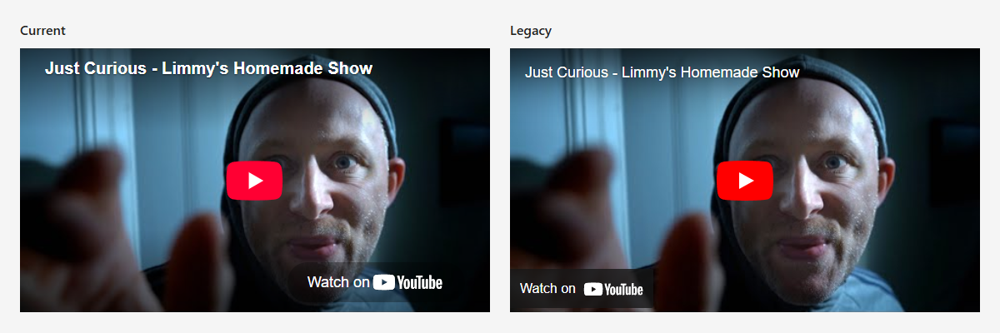

# youtube-embed-html

Lazily embed YouTube videos with a [static placeholder using the `<iframe>` `srcdoc` attribute](https://css-tricks.com/lazy-load-embedded-youtube-videos/), which looks like the YouTube embed (at the time of writing) but doesn't actually embed until you click.

Both the iframe and thumbnail use native browser lazy loading (`loading="lazy"`) by default. Set `loading: 'eager'` to load the placeholder and thumbnail eagerly, for example for a video near the top of the page.



## Install

```sh
npm install youtube-embed-html
```

## Generate an HTML string

```js
import {renderYouTubeEmbed} from 'youtube-embed-html'

const html = renderYouTubeEmbed({
  videoId: 'FfTT7mxGw8I',
  title: "Just Curious - Limmy's Homemade Show",
})
```

## Generate iframe attributes

```js
import {getYouTubeEmbed} from 'youtube-embed-html'

const attributes = getYouTubeEmbed({
  videoId: 'FfTT7mxGw8I',
  title: "Just Curious - Limmy's Homemade Show",
  copyLink: true,
  embedParams: {start: 19},
})
// {loading, src, srcdoc, title, allow, allowfullscreen, frameborder, style}
```

Use this API when your renderer handles HTML serialization, or when you need additional iframe attributes. HTML attribute names are used, so adapters should map names such as `srcdoc` and `allowfullscreen` to their renderer's conventions as needed. Values are unescaped at this outer layer, ready for the renderer to serialise once.

For example, in an Astro component:

```astro
---
import {getYouTubeEmbed} from 'youtube-embed-html'
const attributes = getYouTubeEmbed({
  videoId: 'FfTT7mxGw8I',
  title: "Just Curious - Limmy's Homemade Show",
})
---
<iframe {...attributes} class="video" />
```

The root module works in Node.js, browser modules and server rendering without accessing `document` or `window`.

## Create a DOM element

```js
import {createYouTubeEmbed} from 'youtube-embed-html/dom'

const iframe = createYouTubeEmbed({
  videoId: 'FfTT7mxGw8I',
  title: "Just Curious - Limmy's Homemade Show",
})
iframe.classList.add('video')
document.querySelector('#videos').append(iframe)
```

Pass `iframeAttributes` to set attributes when creating the element:

```js
const featuredVideo = createYouTubeEmbed({
  videoId: 'FfTT7mxGw8I',
  title: "Just Curious - Limmy's Homemade Show",
  iframeAttributes: {
    class: 'video',
    id: 'featured-video',
    style: 'max-width:640px',
  },
})

document.querySelector('#videos').append(featuredVideo)
```

## Layout and iframe attributes

The generated embed uses a responsive 16:9 viewport by default. Set `aspectRatio` to the player's width divided by its height, e.g. for a 4:3 video:

```js
const html = renderYouTubeEmbed({
  videoId: '6AXPnH0C9UA',
  title: 'The Count Censored',
  aspectRatio: 4 / 3,
  iframeAttributes: {
    class: 'video',
    id: 'classic-video',
    style: 'max-width:640px;border:0',
    referrerpolicy: 'strict-origin-when-cross-origin',
  },
})
```

`iframeAttributes` accepts native HTML attribute names and string, number or boolean values. Boolean HTML attributes such as `allowfullscreen` are omitted when `false`, while ARIA and data attributes serialise boolean values as `"true"` or `"false"`. `null` and `undefined` values are skipped and event handler attributes are rejected.

Custom `style` declarations are appended to the responsive defaults. For fixed dimensions, use e.g. `style: 'width:640px;height:480px'`. The same options work with `getYouTubeEmbed`, `createYouTubeEmbed` and `withDefaults`.

## Reuse your own defaults

Wrap any of the three embed functions with `withDefaults()`:

```js
import {renderYouTubeEmbed, withDefaults} from 'youtube-embed-html'

const renderVideo = withDefaults(renderYouTubeEmbed, {
  thumbnailRes: 'maxres',
  copyLink: true,
  embedParams: {rel: 0},
})

const html = renderVideo({
  videoId: 'FfTT7mxGw8I',
  title: "Just Curious - Limmy's Homemade Show",
  embedParams: {start: 19}, // preserves rel: 0
})

// Override a configured default for an older video:
const olderVideo = renderVideo({
  videoId: 'lQKdEdzHnfU',
  title: 'An older video',
  thumbnailRes: 'hq',
  copyLink: false,
})
```

The same helper accepts `getYouTubeEmbed` or `createYouTubeEmbed` and preserves their return types.

Settings take priority in this order: library defaults, configured defaults, then per-embed options. `embedParams` and `iframeAttributes` merge by key. `undefined` values are treated as omitted at both levels, while explicit `false` and `0` override defaults. To reset a configured player parameter, pass its desired value explicitly.

## Options

| Option | Default | Description |
| --- | --- | --- |
| `videoId` | Required | Non-empty YouTube video ID. |
| `title` | Required | Placeholder text, image alternative text and iframe title. |
| `aspectRatio` | `16 / 9` | Player viewport width divided by height. |
| `cookie` | `false` | Pass `true` to use `www.youtube.com` for playback. By default, playback uses `www.youtube-nocookie.com`, YouTube's [privacy-enhanced mode](https://support.google.com/youtube/answer/171780?hl=en#zippy=%2Cturn-on-privacy-enhanced-mode) (🧂🤏).<br><br>YouTube says embedded views in this mode aren't used to personalise the viewer's YouTube browsing experience. |
| `copyLink` | `false` | Pass `true` to recreate YouTube's copy link button. Adds ~2.2 KB of HTML (~0.75 KB gzipped), including a small script inside the placeholder.<br><br>The copied URL includes the start time from `embedParams.start`, if provided. Works independently of `noLink` and is ignored with `legacy`.<br><br>Appears when the Clipboard API is available. Requires a secure context and clipboard permission. |
| `embedParams` | `{autoplay: 1}` | [YouTube player parameters](https://developers.google.com/youtube/player_parameters#Parameters), merged over these defaults.<br><br>For example, `{start: 19, end: 22}` plays a section of the video. Times are in seconds. `start` is also included in the watch URL. |
| `iframeAttributes` | `{}` | Native HTML attributes for the outer iframe. |
| `loading` | `'lazy'` | Loading attribute for both the iframe and thumbnail: `'lazy'` or `'eager'`. |
| `legacy` | `false` | Pass `true` to recreate the classic embed appearance. |
| `noLink` | `false` | Pass `true` to omit the "Watch on YouTube" link, saving ~3.5 KB of HTML (~1.4 KB gzipped). Independent of `copyLink`.<br><br>The link is recreated by default because some users prefer not to watch embedded videos, or to use the link to [download the video](https://github.com/yt-dlp/yt-dlp#readme) instead. |
| `thumbnail` | `'default'` | Select the image shown in the placeholder. Pass `'default'` to use the video's YouTube thumbnail, `1`, `2` or `3` to use one of the three screenshots YouTube provides from the video, or an image URL to use your own thumbnail. YouTube thumbnails load from `i.ytimg.com`.<br><br>**Note:** Some older videos have higher-resolution alternate screenshots available than their default thumbnail. |
| `thumbnailRes` | `'hq'` | Choose the resolution of the YouTube thumbnail shown in the placeholder. Accepts `120`, `320`, `480`, `640` or `1280`, including numeric strings.<br><br>Aliases: `'default'` (120), `'medium'`/`'mq'` (320), `'high'`/`'hq'` (480×360), `'standard'`/`'sd'` (640), `'maxres'` (1280).<br><br>**Note:** Higher resolutions are not available for every video, especially older ones. |

Size estimates are per embed with the default appearance. Gzipped sizes depend on the surrounding page.

Content security policies must allow the placeholder's inline styles and, when enabled, its inline copy script.

Exported types: `YouTubeEmbedOptions`, `YouTubeEmbedDefaults`, `YouTubeEmbedAttributes`, `IframeAttributes`, `EmbedParams`, `Thumbnail`, `ThumbnailRes`, and `ToggleParam`.

## License

MIT
